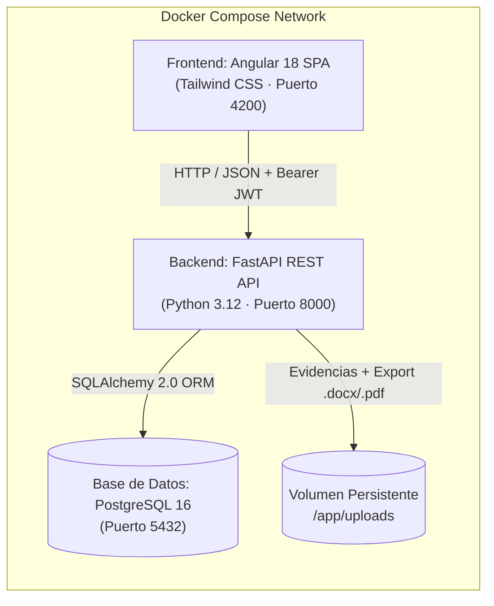

# Mesa de Servicio TI & Informe Mensual de Actividades (GLPI-Lite)

Plataforma interna para departamentos de **Tecnologías de la Información (TI)** que centraliza la **gestión de incidentes y soporte técnico (estilo GLPI ligero)** junto con la generación automatizada del **Informe Mensual de Actividades** con evidencia fotográfica exportable en tiempo real a **Word (`.docx`)** y **PDF (`.pdf`)**.

---

## Características Principales

### 1. Mesa de Ayuda y Gestión de Tickets TI
* **Clasificación estructurada:** Registro por Sede, Categoría y Subcategoría dependiente, Prioridad (`Baja`, `Media`, `Alta`, `Crítica`), Impacto y Fecha de Compromiso.
* **Flujo colaborativo TI:** Asignación y reasignación de casos entre técnicos de soporte e infraestructura.
* **Bitácora de Seguimiento (Timeline):** Historial auditable de cambios de estado (`Abierto`, `En Proceso`, `Pendiente Ext`, `Escalado`, `Cerrado`, `Cancelado`), comentarios técnicos y archivos adjuntos por cada intervención.
* **Cierre con bloqueo automático y SLA:** Al cerrar un ticket se registra automáticamente la marca de tiempo final, se bloquea contra modificaciones posteriores y se calcula el **tiempo promedio de resolución (SLA en horas)**.

### 2. Informe Mensual de Actividades (Word y PDF)
* **Registro progresivo día a día:** Cada integrante de TI registra su actividad diaria, sube la fotografía de evidencia y documenta el entregable obtenido.
* **Agrupación automática por semanas:** El motor clasifica cada registro en `Semana 1`, `Semana 2`, `Semana 3` o `Semana 4` según el día del mes.
* **Exportación instantánea (`.docx` y `.pdf`):** En cualquier día del mes (desde el día 1 hasta el cierre el día 30), el usuario o el coordinador puede descargar el documento oficial con celdas combinadas por semana y **las fotografías de evidencia redimensionadas e incrustadas**.

### 3. Seguridad y Control de Acceso
* Autenticación basada en **JWT (`PyJWT`)** y contraseñas encriptadas con **`bcrypt`**.
* Protección contra fuerza bruta (bloqueo temporal tras 7 intentos fallidos en 15 minutos por IP o usuario).
* **Onboarding seguro:** Al crear un nuevo integrante o restablecer su credencial, el sistema fuerza el cambio obligatorio de contraseña en su primer inicio de sesión.

---

## Arquitectura y Stack Tecnológico



* **Frontend:** Angular 18 (Standalone Components), TypeScript, Tailwind CSS, Phosphor Icons.
* **Backend:** FastAPI (Python 3.12), SQLAlchemy 2.0, Pydantic v2, `python-docx`, `fpdf2`, `Pillow`.
* **Base de Datos:** PostgreSQL 16.
* **Infraestructura:** Docker & Docker Compose.

---

## Despliegue Rápido con Docker

### Requisitos previos
* [Docker Desktop](https://www.docker.com/products/docker-desktop/) instalado y en ejecución.

### 1. Clonar y levantar los contenedores
```bash
git clone <URL_DEL_REPOSITORIO>
cd proyeco1
docker compose up --build -d
```

### 2. Accesos locales
* **Aplicación Web (Frontend Angular):** [http://localhost:4200](http://localhost:4200)
* **Documentación Interactiva API (Swagger UI):** [http://localhost:8000/docs](http://localhost:8000/docs)

### 3. Cuentas de prueba preconfiguradas (Seed automático)
Al iniciar por primera vez, el backend poblará automáticamente las sedes, categorías, subcategorías, tickets de muestra y tres cuentas del área de TI:

| Rol | Usuario | Contraseña | Propósito |
| :--- | :--- | :--- | :--- |
| **Administrador TI** | `admin` | `admin123` | Acceso completo (Dashboard global, Usuarios, Catálogos, Supervisión de informes) |
| **Técnico Nivel 2** | `cmendoza` | `cmendoza123` | Bandeja de tickets asignados e informe mensual propio |
| **Infraestructura** | `lgomez` | `lgomez` | Cuenta configurada para probar el flujo obligatorio de cambio de clave en el 1er login |

---

## Estructura del Proyecto

```text
├── backend/
│   ├── app/
│   │   ├── main.py              # Entrada FastAPI, CORS, ciclo de vida y montaje de archivos
│   │   ├── config.py            # Configuración por variables de entorno
│   │   ├── database.py          # Motor SQLAlchemy y sesión PostgreSQL
│   │   ├── models.py            # Esquema relacional (Users, Tickets, Historial, ActivityLogs, Catálogos)
│   │   ├── schemas.py           # Validación de datos Pydantic v2
│   │   ├── auth.py              # JWT, bcrypt, control de fuerza bruta y validación MIME/extensión
│   │   ├── exporters.py         # Motor de generación Word (.docx) y PDF con imágenes incrustadas
│   │   ├── seed.py              # Poblado inicial automático
│   │   └── routers/             # Endpoints modulares (auth, tickets, activities, users, catalogs)
│   ├── Dockerfile
│   └── requirements.txt
├── frontend/
│   ├── src/
│   │   ├── app/
│   │   │   ├── auth/            # Layout y páginas de autenticación (login, cambio de clave)
│   │   │   ├── private/         # Módulos operativos (panel, tickets, informes, usuarios, configuracion)
│   │   │   ├── shared/          # Components, guards, interceptors, models, pages, services y utils
│   │   │   ├── app.config.ts
│   │   │   ├── app.routes.ts
│   │   │   └── app.ts
│   │   ├── environments/        # Configuración de entornos (desarrollo y producción)
│   │   ├── styles/              # Sistema de diseño editorial minimalista (styles.css)
│   │   ├── index.html
│   │   └── main.ts
│   ├── Dockerfile
│   ├── nginx.conf
│   └── tailwind.config.js
└── docker-compose.yml
```
